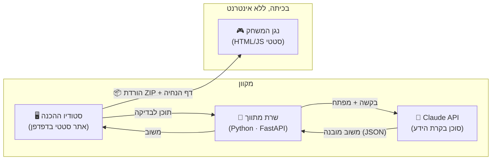

# 🧭 מסע הידע · Knowledge Journey

[](https://github.com/NavaMalka80/knowledge-journey/actions/workflows/ci.yml)


**משחק למידה כיתתי שעובד בלי אינטרנט, עם סוכן AI שבודק את איכות התוכן הפדגוגי.**

מורות ומתכשרות להוראה בונות משחק שאלות לפי תבנית קבועה של שבע תחנות.
סוכן בינה מלאכותית נותן להן משוב כמו מנטורית: מה טוב, מה לשפר, ומה מתאים לגיל.
את המשחק המוכן מורידים ומפעילים בכיתה על מסך מרכזי, עם קליקרים, ללא תלות ברשת.

> **עיקרון מוביל:** את מנגנון החוויה מפתחים פעם אחת. התוכן הלימודי מתחלף בכל הפעלה.

---

## ✨ יכולות עיקריות

| | יכולת | תיאור |
|---|---|---|
| 📝 | **סטודיו הכנה** | תבנית מובנית: כרטיס זהות (גיל, נושא, מטרות), שאלות, מסיחים, נימוקים ומדיה לכל תחנה |
| 🤖 | **סוכן בקרת ידע** | משוב פדגוגי מובנה לפי מחוון. **הסוכן מבקר, הוא לא כותב:** המורה כותבת את התוכן ומחליטה מה לתקן |
| ✅ | **אדם בלולאה** | כל הצעת תיקון של הסוכן נכנסת לתוכן רק אחרי אישור מפורש של המורה |
| 📦 | **משחק אופליין** | הורדה של קובץ ZIP אחד שנפתח בדפדפן במחשב הכיתה ועובד בלי אינטרנט |
| 🎛️ | **לוח מנחה** | שליטה בקצב, פתיחה וסגירה של הצבעה, חשיפת תשובה וכפתורי חירום |
| 📊 | **דוחות** | אחוזי הצלחה לפי שאלה, תחנה ומושג, וייצוא ל-CSV |
| 📄 | **דף הנחיה למנחה** | נוצר אוטומטית: קהל יעד, מטרות, מהלך המפגש ותשובות |

## 🏗️ ארכיטקטורה



- **החומרים לא נשמרים בשרת.** הם נשמרים בדפדפן של המורה ובקובץ פרויקט שלה.
- **מפתח ה-API נמצא רק בשרת המתווך.** הוא לא מופיע בקוד של הדפדפן.
- **הנגן עצמאי לגמרי:** אין בו שרת, אין CDN ואין קריאות רשת.

פירוט מלא נמצא ב-[`docs/ARCHITECTURE.md`](docs/ARCHITECTURE.md), ונימוקי ההחלטות ב-[`docs/adr/`](docs/adr/).

## 🧰 טכנולוגיות

| שכבה | טכנולוגיה |
|---|---|
| מודל נתונים וולידציה | Python 3.12 · Pydantic · JSON Schema |
| שרת וסוכן AI | FastAPI · Anthropic SDK · Structured Outputs · Prompt Caching |
| נגן וסטודיו | HTML · CSS · JavaScript (ללא תלויות חיצוניות) · RTL מלא |
| איכות | pytest · ruff · mypy (strict) · pre-commit · Evals לסוכן |
| CI/CD | GitHub Actions · GitHub Pages |

## 🚀 התחלה מהירה

דרישות: Python 3.12 ומעלה, ו-[uv](https://docs.astral.sh/uv/).

```bash
git clone https://github.com/NavaMalka80/knowledge-journey.git
```

```bash
cd knowledge-journey
```

```bash
uv sync
```

```bash
uv run pytest
```

כל פקודות הפיתוח מתועדות ב-[`CLAUDE.md`](CLAUDE.md#פקודות).

## 📁 מבנה המאגר

```
knowledge-journey/
├── src/knowledge_journey/   # קוד Python: מודל הנתונים, הסוכן, השרת
├── tests/                   # בדיקות אוטומטיות
├── docs/
│   ├── ROADMAP.md           # תוכנית העבודה לפי שלבים
│   ├── LEARNING.md          # יומן לימוד: מושגים שנלמדו בכל שלב
│   ├── ARCHITECTURE.md      # ארכיטקטורה מפורטת
│   ├── adr/                 # Architecture Decision Records
│   └── spec/                # מסמך האפיון המקורי של הלקוחה
├── .github/workflows/       # CI
└── CLAUDE.md                # הקשר והנחיות לסוכן הפיתוח (Claude Code)
```

## 🗺️ סטטוס ותוכנית עבודה

הפרויקט בפיתוח. ההתקדמות לפי שלבים מתועדת ב-[`docs/ROADMAP.md`](docs/ROADMAP.md).

## 🤝 פיתוח בעזרת AI

הפרויקט מפותח בשיטת **AI-assisted development** עם [Claude Code](https://claude.com/claude-code):
- **`CLAUDE.md`** מגדיר לסוכן הפיתוח את עקרונות המוצר, המוסכמות וזרימת העבודה.
- כל שלב מתבצע בענף נפרד, עובר CI ונבדק ב-Pull Request.
- **`docs/LEARNING.md`** מתעד את המושגים שנלמדו בכל שלב.

---

<sub>פרויקט לקוח · כל הזכויות שמורות</sub>
