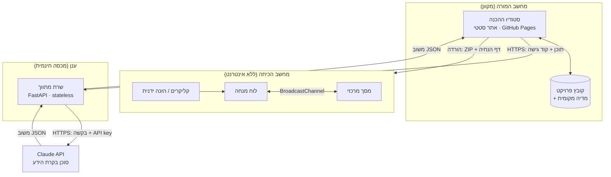
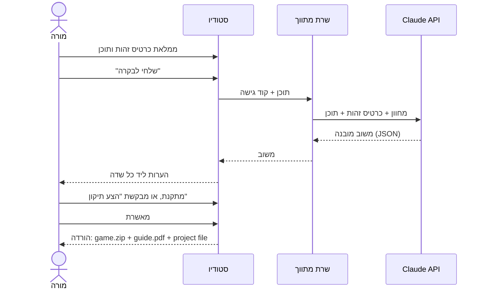

# 🏗️ ארכיטקטורה

## תמונה כללית

## רכיבים

| רכיב | אחריות | טכנולוגיה | שומר מידע? |
|---|---|---|---|
| **מודל הנתונים** | הגדרה אחת של "משחק", ולידציה וייצוא JSON Schema | Python · Pydantic | לא |
| **סטודיו ההכנה** | כרטיס זהות, תבנית, מדיה, משוב, אישור וייצוא | HTML/CSS/JS | רק בדפדפן ובקובץ של המורה |
| **שרת מתווך** | מחזיק את מפתח ה-API, אוכף קוד גישה והגבלת קצב, מריץ את לוגיקת הסוכן | Python · FastAPI | **לא** (stateless) |
| **סוכן בקרת הידע** | בדיקה פדגוגית לפי מחוון, החזרת משוב מובנה | Claude API · Structured Outputs | לא |
| **נגן המשחק** | הפעלה בכיתה: מסך, לוח מנחה, הצבעות, ניקוד ודוח | HTML/CSS/JS ללא תלויות | תוצאות במחשב הכיתה בלבד |

## זרימת עבודה של מורה

## מקור אמת אחד למבנה המשחק

המבנה מוגדר **פעם אחת** ב-Python (Pydantic) ומיוצא ל-**JSON Schema**.
- השרת משתמש במודלים ישירות.
- הסטודיו והנגן (JavaScript) מוודאים מול ה-Schema.
- כך אין "שתי גרסאות" של אותה הגדרה שעלולות להתפצל.

## אילוצים מרכזיים

| אילוץ | השלכה |
|---|---|
| הכיתה עלולה להיות בלי אינטרנט | הנגן סטטי לגמרי, בלי CDN, ועובד מ-`file://` |
| אין תקציב לאחסון | אין שמירת חומרים בשרת. הסטודיו סטטי ב-GitHub Pages |
| מפתח API עולה כסף | המפתח רק בשרת המתווך, עם קוד גישה, הגבלת קצב ותקרת הוצאה |
| דגם הקליקרים טרם נבדק | שכבת מתאמים (Adapter): ידני ומקלדת קודם, ציוד אמיתי בהמשך |
| פרטיות תלמידות | אין זיהוי אישי. הדוחות קבוצתיים |

## רשומות החלטה (ADR)

- [0001: משחק אופליין ללא שמירת חומרים בשרת](adr/0001-offline-first-no-server-storage.md)
- [0002: שרת מתווך להגנה על מפתח ה-API](adr/0002-api-key-proxy.md)
- [0003: הסוכן מבקר, הוא לא כותב](adr/0003-ai-reviews-not-authors.md)
